# Pyroclast

> A real-time C++ graphics and simulation project exploring scalable, high-fidelity explosion and smoke effects across Direct3D 12 and Vulkan.

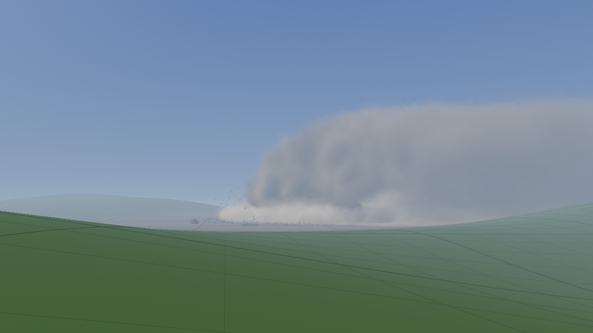

*The lingering barrage (240 artillery impacts, four a second) at tick 3,600 (60 s), from the far view: a minute of
smoke risen into one pall, lit on top and dark beneath, carried downwind and fading into the haze. D3D12 in-app
capture, the realism model.*

**Status:** milestones M11-M27 complete. Windows x64, Direct3D 12 and Vulkan. The default is the realism model
(lingering smoke without pops, smoke physics, visible blast waves, and since M26 a helicopter whose rotor wash moves the
smoke and raises dust); `--realism=off` runs the earlier model, which the seven M20 benchmarks keep.

**Technology:** C++20, CMake 4.2, SDL 3.4.18, Direct3D 12, Vulkan 1.3, HLSL compiled by DXC to DXIL and SPIR-V,
Dear ImGui 1.92.9b, GPU compute.

## Contents

[What and why](#what-and-why) ·
[Results at a glance](#results-at-a-glance) ·
[Gallery](#gallery) ·
[Features](#features) ·
[Architecture](#architecture) ·
[GPU particle pipeline](#gpu-particle-pipeline) ·
[Smoke model](#smoke-model) ·
[D3D12 and Vulkan](#d3d12-and-vulkan) ·
[Performance](#performance) ·
[Optimization record](#optimization-record) ·
[Correctness and validation](#correctness-and-validation) ·
[Limitations](#limitations) ·
[Future work](#future-work) ·
[Build](#build) ·
[Run](#run) ·
[History](#history)

## What and why

The core question:

> How can dense, believable explosion smoke remain performant when many explosions occur simultaneously?

A single high-quality explosion is easy to make expensive. The engineering problem is keeping visual quality as
the workload scales: one explosion, several at once, sustained artillery, overlapping and long-lived smoke, large
particle counts. Pyroclast investigates how to preserve the *perceived visual density* of the effect while keeping
the simulation and rendering workload bounded.

The realism phase (M22-M25) adds the second half of the question: smoke that lingers for a minute or more and rises
into columns, as artillery smoke does, without ever popping out of the scene when the particle budget runs out. M26
adds a source of moving air: a helicopter whose rotor downwash pushes that smoke around and blows dust up from the
ground beneath it. M27 is a look pass after two Blastcore references: the star of smoke tendrils an impact throws out
behind its clods, a size mix of clods, and a downwash that visibly tears the smoke it hits.

The rendering side is held to one rule: build exactly enough rendering infrastructure to support and study scalable
explosion and smoke simulation well, not a renderer that could theoretically support anything.

Out of scope: gameplay, multiplayer, AI, weapons systems, a world editor, a generic ECS, a general-purpose engine,
runtime renderer hot-swapping, support for every graphics API, physically exact fluid dynamics and proprietary
engine integration.

This project is an independent technical exploration.

It is not affiliated with Bohemia Interactive, Arma, Enfusion, or Blastcore, and does not use proprietary engine source code.

## Results at a glance

Measured on an i9-13900K and an RTX 4090 (driver 617.14), Windows 10 Pro 22H2 (19045.6466), Release, 1280x720,
VSync off. Points 1, 4 and 5 come from the M20 benchmark session (5 interleaved runs per case, 120 warm-up frames
per launch; details under [Performance](#performance)); points 2 and 3 from the M19
[optimization record](#optimization-record) and the M20 region timestamps.

1. **GPU time grows with the smoke on screen.** The GPU frame average is 0.056 ms for one small explosion,
   1.575 ms for 100 at once, and 12.151 ms (p95 27.295 ms, 1.6 times a 60 Hz frame) for 100 heavy explosions seen
   from the ground (D3D12).
2. **Translucent particles are the frame.** At full resolution the particle pass is 97.8-99.9% of the draw
   interval in every frozen grid-100 and bombardment state of the M19 baseline. By region timestamps, the simulation, scan and scatter dispatches together average at
   most 0.041 ms on any benchmark.
3. **Draw time follows screen coverage, not particle count.** Over 64,470 frames, R² is 0.979 for smoke
   coverage against 0.334 for the alive particle count, about 5 µs of draw per screen of coverage.
4. **A recommended set** (`--smoke-resolution=auto --half-light --smoke-lod=16`) lowers the GPU frame average on
   all seven benchmarks on both APIs, by 5.00% (single, Vulkan) up to 84.20% (smoke-field, D3D12). It is not the
   default, because each of its parts changes the image.
5. **The two APIs agree, and runs are deterministic.** Vulkan's GPU frame average is within -6.01% to +4.67% of
   D3D12's. Particle counts and their checksums are identical across runs (112/112 checks) and across APIs (7/7).
6. **The realism model fits a 60 Hz frame at 1080p.** At 1920x1080 the lingering barrage (240 artillery impacts, four
   a second, smoke lingering 60-90 s, every blast wave visible) costs 7.85 / 8.20 ms of GPU frame at p95
   (D3D12 / Vulkan), 47-49% of 16.7 ms, with every option off; 4.26 / 4.50 ms with the
   recommended set. Seen from the far view it costs 3.10 / 3.26 ms (M25 session, details under
   [Performance](#the-realism-model-at-1920x1080)).
7. **Nothing pops.** Between consecutive frames through an explosion's graduation, under a saturating stress script
   and from a still camera over a barrage, no step stands out from its neighbours. At a graduation the largest step is
   1.5-2.7 times the median, with the next largest within 3% of it; over a barrage the larger steps are the four
   frames after each impact, as its smoke and the push move. M21's evict-oldest pop, for comparison, is one step 4.9
   times the median.
8. **A helicopter in the smoke fits too.** Its rotor's air moves every lingering particle within reach, and its
   brownout raises up to about 2,400 dust puffs. Over the same barrage it adds 1.57 / 1.75 ms of GPU frame at p95
   (9.42 / 9.95 ms, D3D12 / Vulkan), nearly all of it drawing the dust: the air itself costs about 0.005 ms of compute.
   On every scripted frame without explosions, the GPU's dust count equals the CPU's prediction.

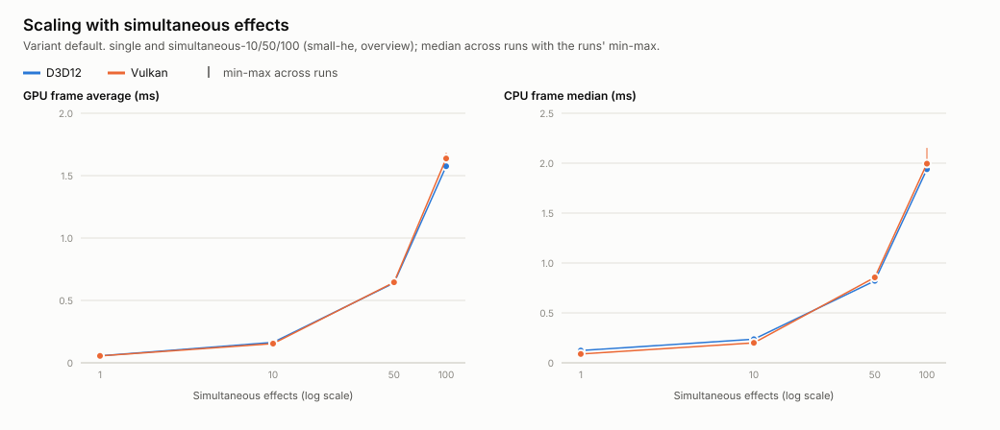

## Gallery

All images are in-app captures of the default 1280x720 window, copied on the GPU before presentation; the one
difference image is `ImageDiff`'s. Captions
give the state, the renderer and build, and any non-default flag.

The realism model (the default since M25):

| | |
|---|---|
| 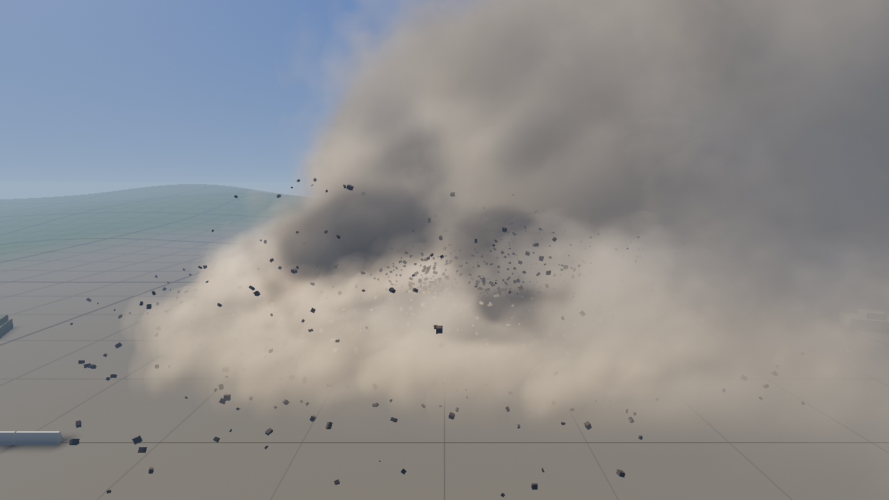<br>The lingering barrage at tick 1,800 (30 s), overview: older columns rise and drift behind the newest impact. D3D12, Debug. | 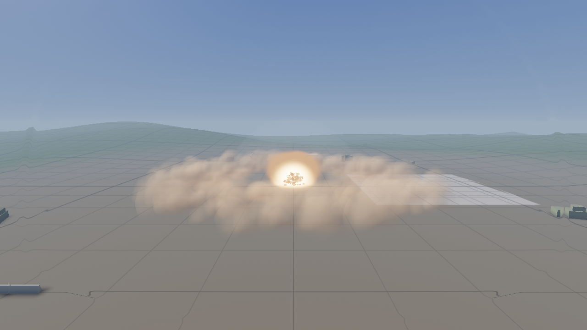<br>One heavy charge at tick 8, humidity 80%: the brief condensation (Wilson) dome around the fireball, the dust skirt kicked up where the front passed, and the refraction ring bending the ground's lines far out. D3D12, Debug. |
| 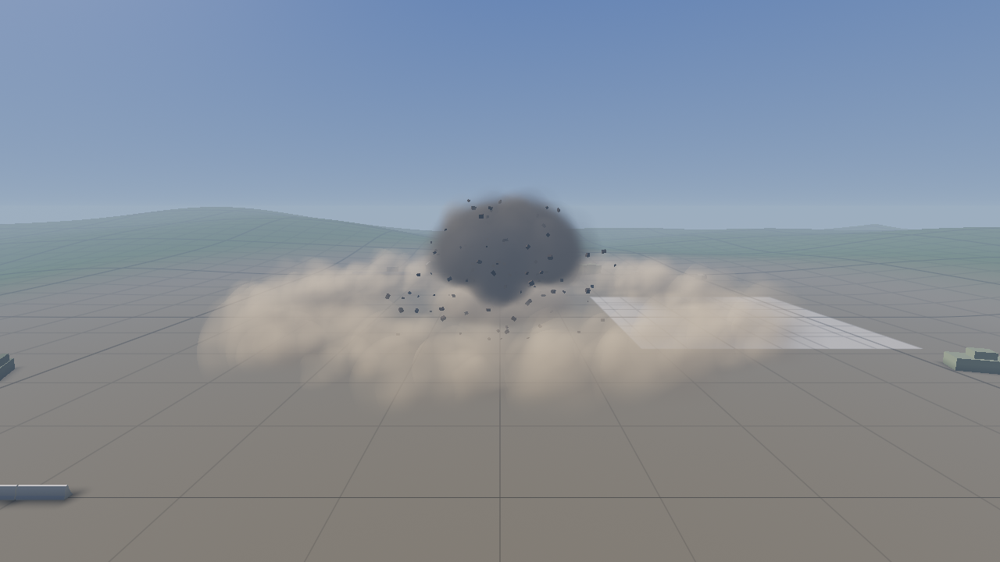<br>The same charge at tick 60 (1 s): the soot-dark young cloud with its ejecta above the skirt's dust, thrown outwards along the ground. D3D12, Debug. | 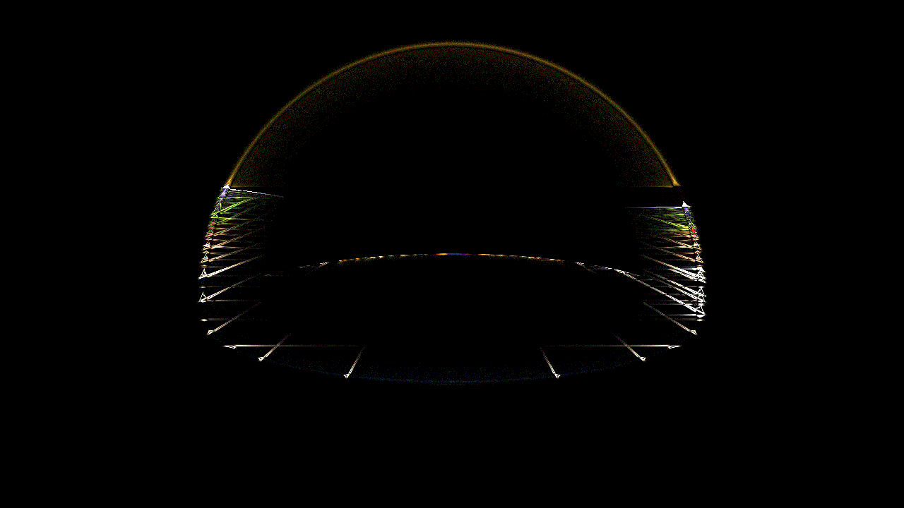<br>An artillery charge at tick 6: the refraction ring's effect on the image, the difference against `--disable=waves` amplified 40 times (the ground ring and the air shell's arc). D3D12, Debug. |

The helicopter (M26), in the `heli-hover` script over the lingering barrage:

| | |
|---|---|
| 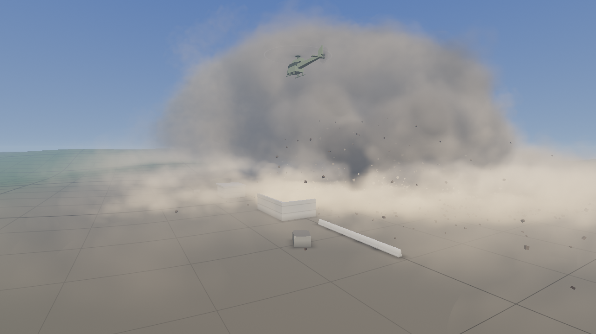<br>Tick 3,700 (62 s): after 12 s hovering 70 m over the pall, the helicopter comes down through it at 3 m/s. The pall is pressed down and spread, its base turned into a sheet of brownout dust. D3D12, Debug. | 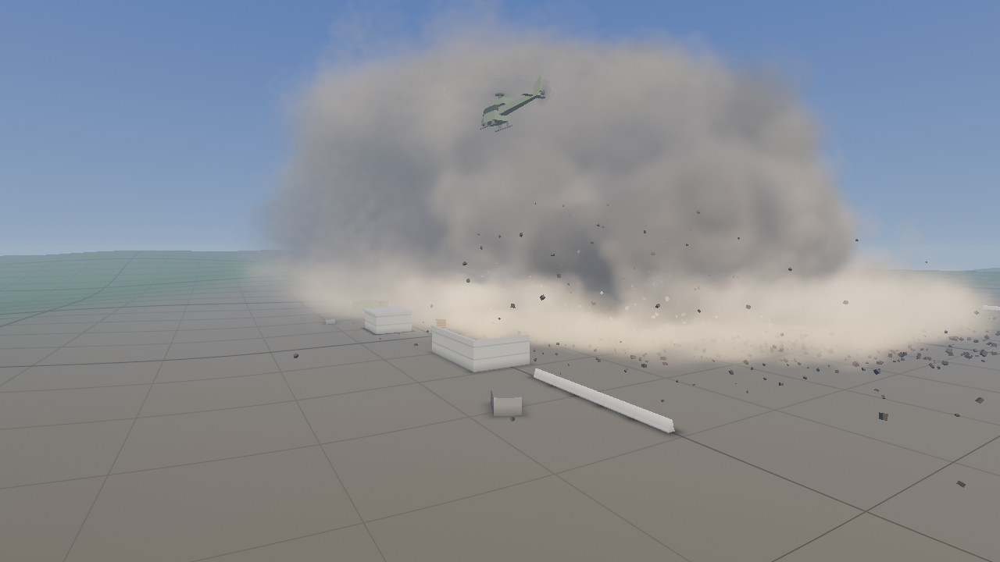<br>The same frame with `--disable=rotor` (no air and no dust; the helicopter still flies): the pall keeps the barrage's shape and the ground stays clear. D3D12, Debug. |
| 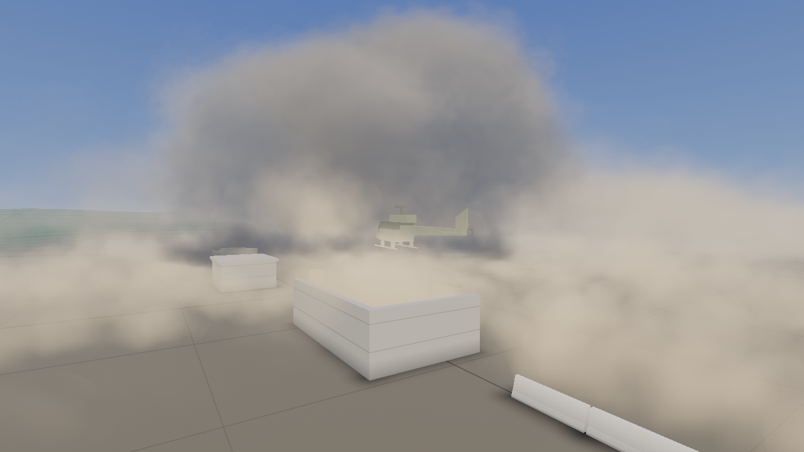<br>Tick 4,800: the low hover, the hub 8 m up, inside its own brownout, behind the range's crates and barrier. D3D12, Debug. | 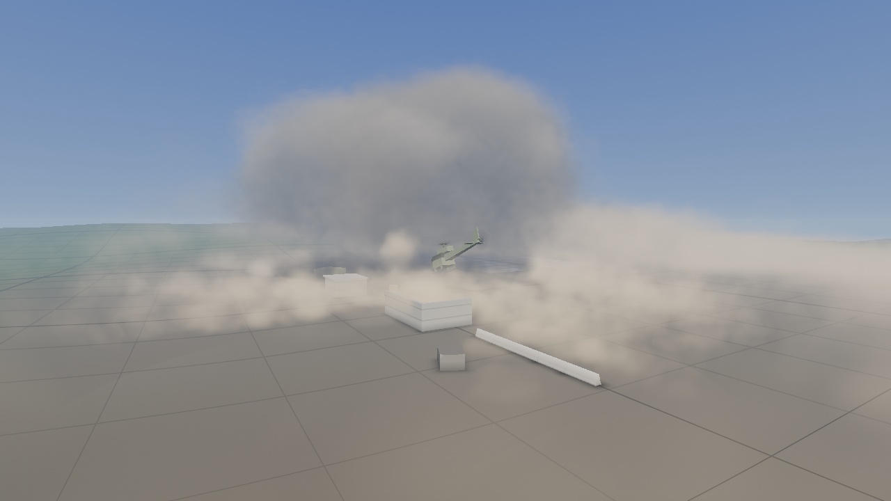<br>Tick 5,000: climbing out east, the dust still rolling where it hovered. D3D12, Debug. |

The earlier model (`--realism=off`), as M21 captured it:

| | |
|---|---|
| 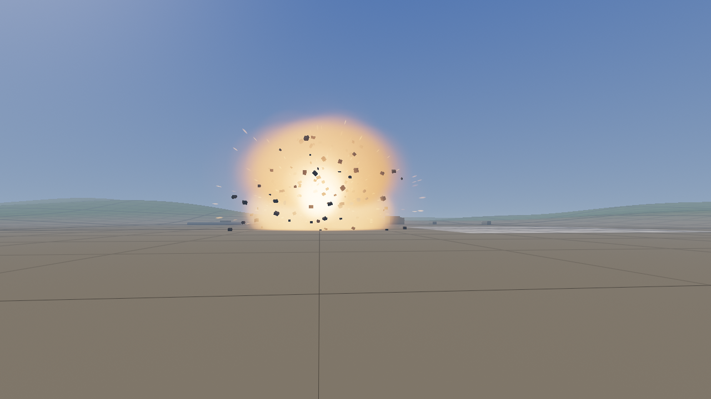<br>One heavy explosion at tick 45 (0.75 s), from eye level: the fireball stage. D3D12, Debug. | 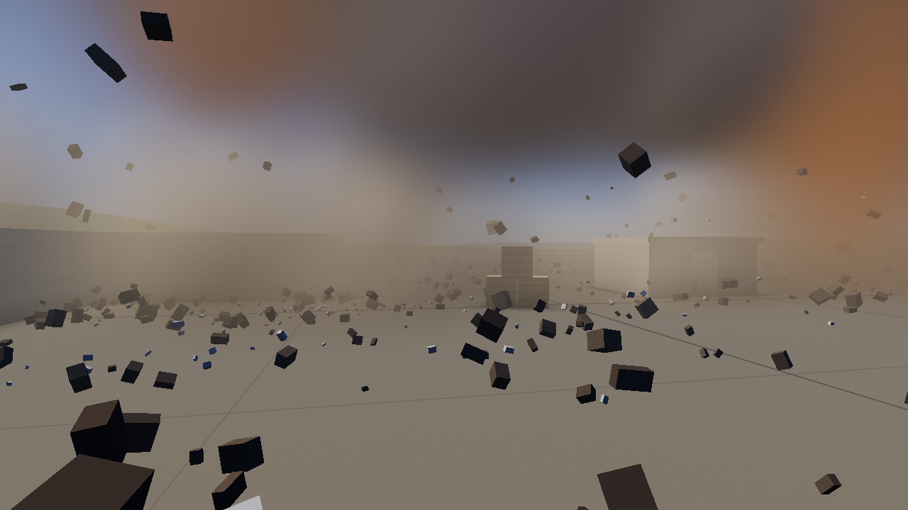<br>The `range` scenario (seven explosions of six presets among the north yard's props) at tick 180, from the yard view. D3D12, Debug. |
| 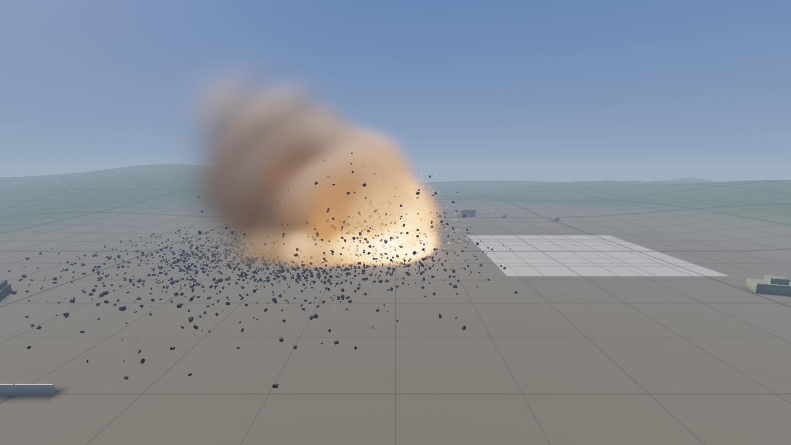<br>The `barrage` scenario (80 artillery-he impacts walking across the range) at tick 600 (10 s), overview. D3D12, Debug. | 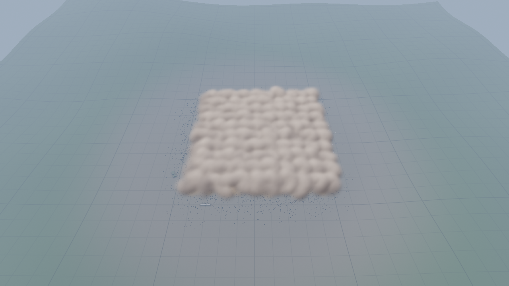<br>100 small-he explosions started together, tick 180, aerial view. D3D12, Debug. |
| 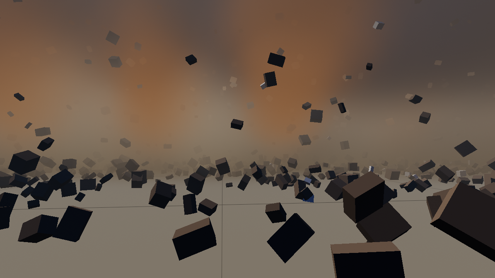<br>The smoke-field workload (100 heavy explosions, from the ground) at tick 180, every option off. D3D12, Debug. | 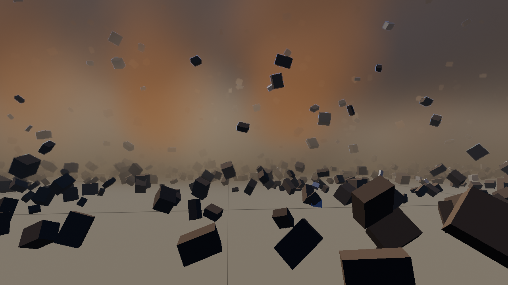<br>The same frame with `--smoke-resolution=auto --half-light --smoke-lod=16`: the image cost of the recommended set. D3D12, Debug. |
| 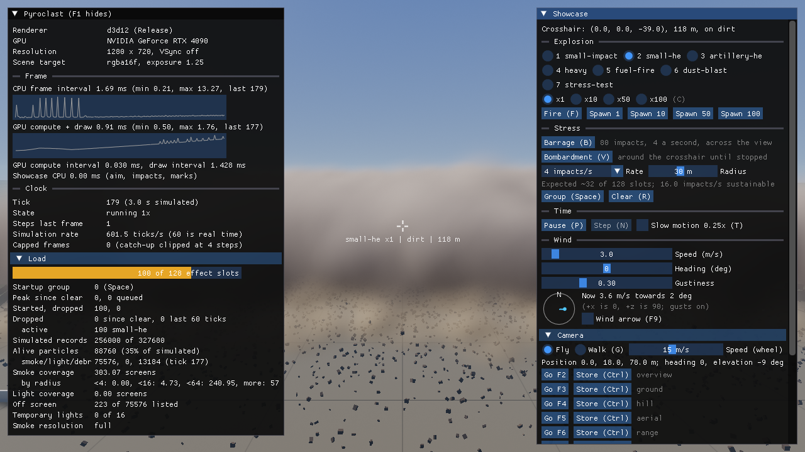<br>The overlay (`--ui=on --coverage`) over 100 small-he explosions at tick 180. D3D12, Release. A single live reading: no number in this README is taken from it. | 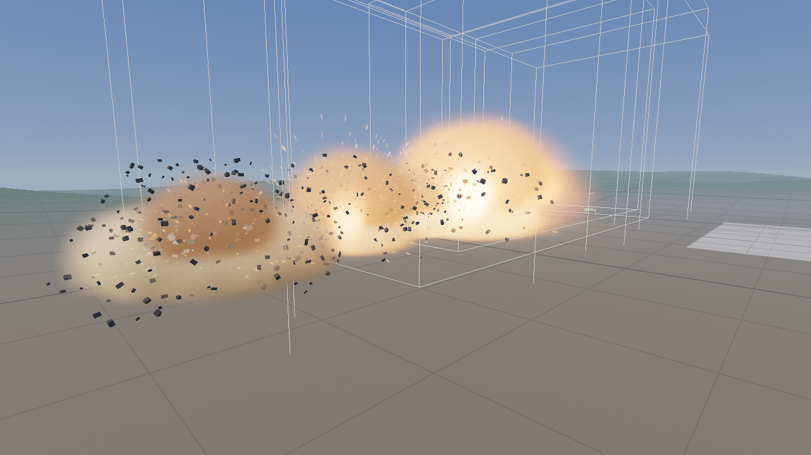<br>`--effect-lines` on the `range` scenario at tick 45, range view: each effect's origin, normal and reach, and the props' collision boxes. D3D12, Debug. |

## Features

| Area | What it does |
|---|---|
| Test range | A 512 m procedural heightfield (257x257 heights, 2 m apart) with a flat central range, sun and hemisphere light, fog and a sky. A 36x36 m concrete pad. 18 props (walls, a hut, crates, a truck, barriers, rocks, a tank, a burnt car) built in code from 36 boxes, no asset files, drawn as one 1,764-vertex mesh. |
| Explosions | Events placed by clicks or scripts at any time and place. 7 presets (small impact, small HE, artillery HE, heavy, fuel/fire, dust blast, stress test), each a table of up to 7 layers: ground dust, blast smoke, plume, flash, fireball, sparks, debris. Dirt and concrete respond differently. Up to 16 temporary lights per frame, the brightest first. Under the realism model (M27) an HE impact throws clods along ballistic arcs, each trailing a chain of dark smoke knots (the star), and its debris comes in a size mix. |
| Environment | Sparks and debris collide with the terrain and the props (swept, so nothing tunnels through a thin wall); debris comes to rest on tops; dust is held back and stays on tops; the wind and each explosion's vortex ring turn aside and up over walls. |
| Showcase | Aim and fire with the crosshair; counts 1, 10, 50 and 100 (the aimed explosion plus a Vogel disc of radius 16.3, 36.6 or 51.6 m around it); an 80-impact barrage across the view; a continuous bombardment; walk or fly; seven camera bookmarks; 0.25x slow motion; debug views (effect bounds, collision boxes, spawn regions, wind arrow). |
| Realism model (default) | The default since M25 (`--realism=off` for the earlier model). Smoke lingers: when an explosion's energetic phase ends, every eighth dust, smoke and plume particle survives into a residual pool of 65,536 particles and takes over its neighbours' share of the smoke, then lives on for about `--linger` seconds (75 by default, varying by explosion) after the explosion. It rises towards a stabilization height that grows with the charge (about 45 m for artillery) and spreads there, so a cloud becomes a column; the wind strengthens and veers with height, so columns lean and drift; every explosion varies a little in height, spread, darkness and life; dust stays low, falls out and settles; and distant smoke fades into the same haze as the ground. The look (M25): a flash and fireball with a real charge's timing, lighting nearby smoke as a sphere; soil jets and soot-dark young smoke that turns to a ground-tied grey; columns that shade themselves and one another, lit on top and dark beneath; thin smoke that scatters sunlight; billowed puffs. Nothing pops: smoke leaves only by fading, a full pool fades its oldest smoke out over at least 2 s, and with every effect slot busy an older explosion graduates early so the new one starts a moment later instead of being dropped. Deterministic on both APIs. Every explosion's blast wave shows: a ring of refraction races over the ground and through the air, a dust skirt is kicked up where it passes, heavy charges in humid air (`--humidity`, 80% by default) flash a brief condensation dome, lingering smoke jolts outwards as the front crosses it and back as the air returns, and in interactive runs the camera shakes when it arrives. |
| Helicopter (M26) | A 10 t helicopter (H in the showcase, or three scripts) whose rotor's air, from momentum theory, ground effect and a skewed wake reaching the ground as a wall jet, moves every lingering particle within reach and (M27) tears the puffs it overlaps, so a hover opens a hole in a pall and a pass leaves a cleared band; in a low hover it raises a low sheet of brownout dust by a saltation law, none from 3 rotor diameters up. A flat-shaded proxy with blurred rotor discs and a soft ground shadow. |
| Scalability options | Coverage counters, an automatic smoke resolution with a coverage budget, half-resolution light, projected-size smoke thinning, a faint-smoke floor, effect-order keys and a slot policy. All off by default. |
| Benchmark mode | 12 named workloads (`--benchmark`; 5 of them for the realism model at 1920x1080, 2 with the helicopter), each after 120 warm-up frames, with a JSON record, a per-frame CSV, an interleaved session driver and a report with charts. |
| Tooling | A Dear ImGui overlay that shows only values the application measures or owns; `--gpu-regions`; in-app capture (`--capture`, `--capture-sequence`); `ImageDiff`; `tools/captures.py`, `tools/ab.py`, `tools/bench`, `tools/counter_log.py`, `tools/lifecycle.ps1`. |

## Architecture

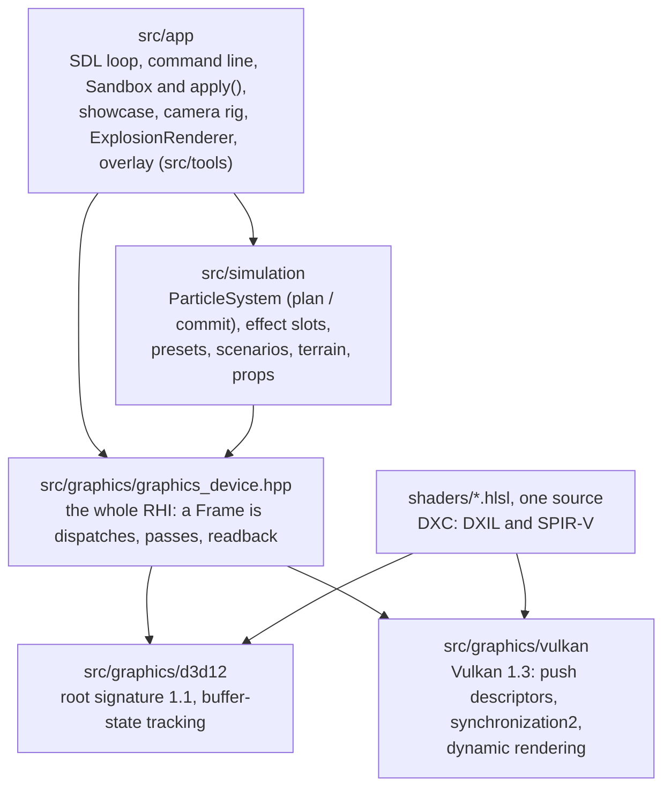

- `create_graphics_device` in `src/graphics/graphics_device.cpp` is the only code that includes both backends;
  native API headers appear nowhere else.
- The simulation layer talks to the RHI only and does not know which backend is active.
- `src/core/math` (vectors, matrices, rays) is shared by the application and simulation layers.

### The frame contract

A frame is every dispatch in order, then every pass in order, then presentation. Backends derive the barriers from
the bindings. There is no command-list, render-graph or general texture abstraction; swapchains, barriers,
fences, descriptors and timestamp queries stay private to each backend. The whole frame, verbatim from
`src/graphics/graphics_device.hpp`:

```cpp
// One frame: every dispatch in order, then every pass in order, then presentation. The backend
// derives the barriers between them from the bindings.
struct Frame
{
    std::span<const Dispatch> dispatches;
    // The last pass, and only the last, draws to the backbuffer.
    std::span<const Pass> passes;
    std::array<float, 4> clear_color{};
    // b1 for every dispatch and draw of the frame; at most binding_layout::frame_constant_bytes.
    std::span<const std::byte> constants;
    // Copies the presented image for read_capture(). Instrumentation only; requires GraphicsDeviceOptions::capture.
    bool capture = false;
    // Dear ImGui draw data drawn over the finished frame; requires GraphicsDeviceOptions::debug_overlay.
    ImDrawData* overlay = nullptr;
    // Bytes copied after the dispatches, between the compute and draw intervals (so outside both), for
    // GraphicsDevice::completed_readback (counters, never bulk data).
    struct Readback
    {
        const Buffer* source = nullptr;
        std::uint32_t offset = 0;
        std::uint32_t size = 0;
    } readback;
};
```

A `Dispatch` is a compute pipeline, its bindings, 16 constants and a group count. A `Pass` names a colour target
(or the backbuffer), up to two earlier targets it samples, an optional depth target (written, or read-only and
sampled), and its draws. `validate_frame` checks this contract once, independently of the API, and is unit-tested.

### One binding model

Every pipeline of the renderer's own uses one binding layout on both APIs (the Dear ImGui overlay uses the
library's stock backends). It is defined once in `shaders/binding_layout.hlsli`, which
C++ includes and CMake parses (verbatim):

```hlsl
// b0: per-draw/dispatch constants (D3D12 root constants, Vulkan push constants).
static const uint draw_constant_words = 16;
// b1: per-frame constants (D3D12 root CBV, Vulkan push-descriptor uniform buffer).
static const uint frame_constant_bytes = 16384;
// t0..t7: read-only buffers. t8..t9: sampled render targets. u0..u5: read-write buffers, dispatches only.
static const uint read_buffer_slots = 8;
static const uint texture_slots = 2;
static const uint write_buffer_slots = 6;

// Vulkan set 0: DXC maps register N of each class to binding N + shift (-fvk-<class>-shift).
static const uint vulkan_b_shift = 0;
static const uint vulkan_t_shift = 2;
static const uint vulkan_u_shift = 12;
static const uint vulkan_s_shift = 18;
```

| Slot | Contents | D3D12 | Vulkan (set 0) |
|---|---|---|---|
| b0 | 16 constant words | root constants | push constants |
| b1 | frame constants, at most 16 KiB | root CBV | uniform buffer, binding 1 |
| t0-t7 | read-only buffers | root SRVs | storage buffers, bindings 2-9 |
| t8-t9 | sampled render targets | one single-descriptor table each | sampled images, bindings 10-11 |
| u0-u5 | writable buffers, dispatches only | root UAVs | storage buffers, bindings 12-17 |
| s0, s1 | linear and point clamp samplers | static samplers | samplers, bindings 18-19 |

- D3D12 uses 48 of the 64 root-signature DWORDs. Vulkan uses 19 push descriptors, checked at startup against the
  device's `maxPushDescriptors`.
- **Vertex pulling.** Vertex shaders load records from buffers at shared offsets, so the renderer's pipelines have
  no input layouts.
  Draws never use a base instance (SPIR-V's `InstanceIndex` includes it, DXIL's `SV_InstanceID` does not); range
  starts are passed as constants.
- **Shared headers.** `shaders/particle_layout.hlsli` (record stride and offsets, counts, group sizes) and
  `shaders/binding_layout.hlsli` contain only `static const uint` lines and are included by both C++ and HLSL.
  `cmake/Shaders.cmake` lists every shader once, generates the `Shader` enum and both backends' bytecode tables,
  and turns the binding layout into DXC's `-fvk-*-shift` options. Shaders compile as shader model 6.0 with HLSL
  2021; SPIR-V targets the Vulkan 1.1 environment.

## GPU particle pipeline

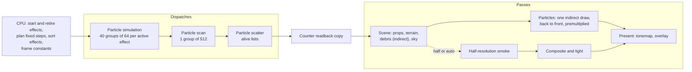

- **Pool.** 128 effect slots, each owning a slab of 2,560 records of 48 bytes: 327,680 records, 15.7 MB, created
  zero-filled on the GPU. The CPU never writes particle data. Only active slabs are simulated and drawn.
- **Effects.** An effect class (a preset on a surface) assigns each 64-record group of a slab to one layer, so a
  wave never diverges by layer. A record whose stored generation differs from its slot's respawns from that slot's
  event; random streams are keyed by the event's seed and the record's index in the slab, so an effect looks the
  same in any slab and on both APIs.
- **Simulation.** A fixed step of 1/60 s; one dispatch runs all of a frame's steps, and catch-up is capped at 4
  steps per frame.
- **Lists.** The simulation writes each group's 64-bit alive mask. One scan group of 512 threads turns the masks
  into per-group list offsets, four indirect argument records (all translucent particles, smoke, light, debris)
  and a 16-word counter record. The scatter writes the alive records' indices. The particle and debris draws are
  indirect and read only alive particles.
- **Readback.** The first 32 bytes of the counter record (64 when measuring coverage) are copied between the
  compute and draw intervals and reach the CPU when that frame's slot is reused. It is the frame's only readback of simulation data; GPU
  timestamps and captures have their own.
- **Order.** The CPU sorts the active effects back to front each frame; within an effect, records keep slab order.
  The lists are a stable compaction, so blending order, images and counts are deterministic.
- **One blend.** A single premultiplied blend state draws smoke and light together, because light writes zero
  alpha. Every particle fades softly where it meets the scene depth.
- **Half resolution** (`--smoke-resolution=half`, or `auto` per frame): smoke goes to a half-size RGBA16F target
  cleared to transparent black, fades against the full-resolution depth, and is composited premultiplied with a
  linear filter; light stays at full resolution unless `--half-light` puts it in the same back-to-front list.
- **Work per frame.** 3 dispatches, 3 passes and 6 draws at full resolution; 3, 4 and 8 at half resolution (7 draws
  with `--half-light`, which moves light into the half-resolution draw).
- **HDR.** The scene renders into an RGBA16F target in linear radiance. The present pass applies exposure,
  Stephen Hill's ACES fit, sRGB encoding and a fixed per-pixel dither.

Measured decisions:

| Decision | Result |
|---|---|
| GPU lifecycle (alive lists, indirect draws) against drawing whole slabs | Up to 47% faster draws where dead particles dominate; a fixed 3-5 µs at light loads |
| Atomic append instead of stable compaction (rejected) | 3-12 µs cheaper per frame, but the blending order, and so the image, changed from run to run |
| Scan: coalesced loads into group-shared counts, 512 threads | 12.2 → 3.9 µs (D3D12, 100 effects) |
| Counter readback between the compute and draw intervals instead of at frame end | Vulkan single-effect CPU median -5.1%: at frame end, its barrier drained the GPU before the frame fence |
| 48-byte records against 64-byte | 64 bytes costs +16% (D3D12) and +45% (Vulkan) compute; 48 kept |

## Smoke model

Smoke aims at physical plausibility, not accuracy. The simulation (`shaders/particles_compute.hlsl`):

| Element | Behaviour |
|---|---|
| Drag | Smoke-like layers relax toward the local air: `v += (air - v) · drag · dt` |
| Wind | 35% of the wind at the ground, all of it from 15 m up |
| Gusts | Computed on the CPU from the tick: sines with periods 7.3, 2.9 and 1.3 s scale the speed within 1 ± gustiness, and the heading swings by up to 12° × gustiness. Default 3 m/s toward +x, gustiness 0.3. |
| Vortex ring | A softened point vortex about the rising ring core: up through the core, out over the top, in underneath; it decays after the rise |
| Ring strength | From 3.5 m²/s with a 7 m rise (small HE) to 20 m²/s with a 26 m rise (heavy) |
| Curl noise | Analytic, no textures; eddies about 8 m across, strongest while the smoke is young |
| Buoyancy | From a temperature derived from age, `heat · exp(-cooling · age)`, so no extra particle state |
| Ground and props | Ground clamp and bounce; contacts with the props' boxes in index order; smoke within two sizes of the ground is pushed up; ground dust stays in a layer that thickens with age |

Rendering (`shaders/particles.hlsl`):
- size grows with age and as the smoke cools; opacity fades in and falls off over the particle's life;
- a particle smaller than a pixel is drawn as a one-pixel square carrying the disc's whole weight, so it does not
  flicker or rasterize differently on each API;
- each smoke particle is shaded as a sphere: wrap lighting `(n·L + 0.6) / 1.6`, half-desaturated sky light, and
  sunlight scattered inside the cloud;
- self-shadowing: the sun ray's chord through a sphere around the vortex ring, `exp(-density · chord)`;
- hot smoke glows, and the explosions' temporary lights light it;
- the soft-particle fade against the scene depth.

Measured (100 artillery-he explosions): curl noise and the vortex ring are effectively free. In the grid-100
scenario the simulation dispatch takes 27.1 µs (D3D12) / 23.4 µs (Vulkan) with everything on, and turning curl
noise off did not make it faster. In the frozen state at tick 180, sphere shading costs 0.12 / 0.20 ms of a
5.8-5.9 ms draw, 2-3.5%. Each part can be switched off (`--disable=curl,vortex,gusts,shading,shadow,emission`).

### The realism model (the default)

Since M25 every run uses the realism model (M22-M25) unless `--realism=off`. The seven M20 benchmarks keep the earlier
(legacy) model, whose frames are M21's exactly.

The goal is the long-lived artillery smoke of combat-simulation mods: smoke that lingers for a minute or more and rises
into grey columns that lean and drift with the wind and fade into the haze. The model also avoids a common flaw of such
effects: when particles run out, a new explosion makes older smoke vanish at once.

- **Two-phase smoke.**
  - An explosion's slab of 2,560 particles runs the energetic phase as before.
  - At its graduation (4-10 s by preset, plus a 1 s crossfade) every eighth dust, smoke and plume particle survives into
    a persistent residual pool of 65,536 particles. It takes over its neighbours' share of the smoke: over the crossfade
    the others fade out while each survivor grows to keep optical depth times area constant, so the move is invisible.
  - The slab is free again after 5-11 s instead of the whole smoke life. The survivors live on for about `--linger`
    seconds (75 by default, 0.87-1.2 times that by explosion).
- **No pops.** Smoke leaves only by fading.
  - A CPU scheduler books the pool by integer ticks when each explosion starts. Older smoke in the way gets a forced fade
    of at least 2 s, and under sustained fire a linger scale shortens lives smoothly.
  - With every effect slot busy, an older explosion graduates early and the new one waits a moment for its slot
    (`--slot-policy=graduate-oldest`, the realism default) instead of being dropped.
- **Physics, faked plausibly.**
  - Lingering smoke rises on an updraft to a neutral height that grows with the charge (about 45 m for artillery, a
    design value) and spreads there. Each explosion's smoke fills a continuous column from a dusty foot to its cap.
  - The wind strengthens and veers with height, so columns lean.
  - Dust stays low, falls out and settles. Older smoke thins as it spreads and stretches along the wind.
  - Every explosion varies a little in height, spread, darkness and life.
  - Distant smoke fades into the same haze as the ground.
- **The look.**
  - An HE charge flashes for a few hundredths of a second, and its fireball cools from yellow-white to deep orange within
    a fraction of a second. Its light falls on nearby smoke as from a sphere the size of the fireball.
  - Young smoke is soot-dark and dense, and turns over a few seconds to a grey tied to the ground it rose from.
- **The star (M27).** An HE impact throws 3-9 clods (by charge; none from a small impact) along ballistic arcs, and each
  lays a chain of dark smoke knots behind it as it flies: a quarter of the blast smoke, born one knot after another at
  exact ticks where the clod has just been. The knots hang where they were laid, sagging a little while the column rises
  around them, and only then drift up and graduate with the rest, so a fresh impact wears a star of tendrils that stands
  two to three fireball heights over artillery. The clods themselves come in a size mix under the realism model: many
  small, a few big chunks that fly, bounce and rest.
  - Each column shades itself at the scale of the whole cloud, lit on top and dark beneath, and the columns of a barrage
    shade one another more deeply as the pall builds.
  - Thin lingering smoke scatters sunlight forwards rather than shading like a ball. Large puffs break into billows.
- **Visible blast waves.** Each preset's shock front comes from Kinney-Graham overpressure and the shock relations,
  integrated per preset into 16 knots. As it passes:
  - a crisp ring of refraction races over the ground and through the air (in the present pass);
  - a sheet of dust is kicked up;
  - heavy charges in humid air (`--humidity`, 80% by default) show a brief condensation dome that clears from the
    inside;
  - other explosions' lingering smoke jolts outwards and back as the air behind the front moves out and returns;
  - in interactive runs the camera shakes as it arrives.

  The charges and stabilization heights are design values, not measurements.
- **Deterministic.** Particle counts stay integer functions of the tick, identical across runs and across D3D12 and
  Vulkan. Every realism feature has a `--disable` name and an overlay checkbox.

### The helicopter (M26)

A helicopter is a source of moving air, not of smoke. Its rotor's downwash moves every lingering smoke and dust particle
near it, and in a low hover it blows dust up from the ground (brownout). Press **H** in the showcase, or run the
`heli-hover`, `heli-pass` and `heli-landing` scripts.

- **The air.**
  - A 10 t helicopter with an 8 m, four-bladed rotor. Momentum theory gives its hover inflow, 14.1 m/s.
  - Forward flight weakens and skews the wake (Glauert), and near the ground the rotor gains thrust (ground effect).
  - The wake reaches the ground as a wall jet that carries the rotor's thrust as momentum, and in a low hover it rolls
    into a recirculating ring.
  - The flow comes from a stream function, so it creates and loses no air while the wake hangs straight down. It is
    evaluated on the GPU for every lingering particle at every step, and by a double-precision twin on the CPU.
  - Smoke inside the wake follows it closely (its drag rises towards 15 /s there); the wind and the helicopter's own
    motion carry the wake along its skew.
  - The bite (M27): a puff that overlaps the wake is torn. It is drawn smaller and far thinner by the air's speed at its
    near edge (entrainment at the jet's edge), while the coupling drives it down and out along the ground, so a hover
    opens a hole in the pall beneath it and a pass through a column leaves a cleared band that the displaced smoke does
    not refill. Explosion dust on the ground lifts where the wake's air passes over it.
- **Brownout.**
  - Dust rises where the outwash beats a saltation threshold (6 m/s), at a rate from a saltation-flux law summed over
    the ground: full at a hover two rotor radii up, weaker higher up, and (M27) none from 3 rotor diameters up (48 m).
  - It is a low, fine sheet (M27): 0.4-1 m puffs that ride the wall jet outwards and curl up at its edge.
  - 2,558 dust particles cycle through 4-10 s lives, each cycle born or not by an integer rule. The CPU therefore counts
    exactly what the GPU draws, and every scripted frame without explosions checks it.
- **The proxy.**
  - A flat-shaded fuselage built in code from 17 boxes, lit like the props.
  - Rotor discs drawn as blurred blades, sorted with the smoke.
  - A soft ground shadow.
  - It all dissolves in and out.
- **Flights.** Scripted at whole ticks, within speed, acceleration and descent-rate limits, nose first.
  - `heli-hover`: a hover 70 m over the pall, a descent through it to a low hover in its own dust, a climb away.
  - `heli-pass`: a slow pass through the pall at 40 m.
  - `heli-landing`: a landing in brownout.
- **What reads.**
  - Low hovers and the landing: the helicopter sits in a thin sheet of its own dust.
  - A hover above the pall presses it down, spreads it and (M27) opens a hole in it, seen from above; from the side the
    pall sits lower and flatter than without the rotor (the gallery's pair).
  - A pass through the pall at 40 m leaves a cleared band behind it, seen from above; from the side it is still subtle.
- **Unchanged without it.** A run without a helicopter draws through M25's shaders, and every earlier image is
  byte-identical.

## D3D12 and Vulkan

| Topic | D3D12 | Vulkan |
|---|---|---|
| Binding | One root signature 1.1: root constants, a root CBV, root SRVs and UAVs (marked `DATA_VOLATILE`), one table per sampled target | One pipeline layout: push constants and one push-descriptor set |
| b1 frame constants | An upload-heap buffer per frame slot | `HOST_VISIBLE \| HOST_COHERENT`, preferring `DEVICE_LOCAL` |
| GPU buffers | Default heap, committed (zero-initialized) | Plain `DEVICE_LOCAL`, zero-filled with `vkCmdFillBuffer` |
| Resizable BAR | No counterpart on Windows 10: `D3D12_HEAP_TYPE_GPU_UPLOAD` needs Windows 11 and the Agility SDK (per Microsoft's documentation) | The 2D prototype moved the pool into host-visible device-local memory: compute 2.02 → 0.016 ms. Plain device-local memory later measured the same. |
| Samplers | Static samplers | Pushed with every draw and dispatch: an immutable sampler that was never pushed filtered as point sampling on driver 617.14 |
| Barriers | Buffer states tracked per command list from COMMON (buffers decay to it after `ExecuteCommandLists`); UAV barriers between dispatches writing one buffer; read states merged, so a buffer read by compute and graphics needs no transition between them | Global memory barriers before, between and after the dispatches; image layouts transitioned per pass; nothing recorded inside dynamic rendering |
| Barrier cost | The generalized barriers cost +1.3 to +2.4 µs of compute interval per frame on both APIs; kept deliberately | (same) |
| Presentation | Flip-discard, 2 buffers; without VSync, interval 0 with tearing allowed where supported | FIFO with VSync; without it, `IMMEDIATE` (required); `minImageCount + 1` images, 3 here |
| GPU region timestamps | Not fenced: a region can overlap neighbouring work | An execution barrier after each region start, so `--gpu-regions` serializes the GPU |
| Debug validation | Requires the debug layer | Requires the validation layer, with synchronization validation |

Shader portability rules, all handled without forking shader logic:
- Vulkan uses a negative-height viewport, so shared HLSL keeps D3D12's clip-space orientation;
- every Vulkan binding sits in set 0 through DXC's per-class register shifts;
- no base vertex or instance;
- `ddx_fine` / `ddy_fine` instead of `fwidth` where results must match (DXIL's derivatives are coarse, SPIR-V's are
  the driver's choice);
- a particle's view distance is passed as an interpolant, because Vulkan's `FragCoord.w` is 1/w;
- debug lines are excluded from cross-API image comparisons: the APIs rasterize lines differently;
- the measuring scatter `cs_measure` is its own entry point and pipeline: a descriptor that a pipeline statically
  uses must be valid on Vulkan even when a flag skips it.

Measured differences (M20 benchmark session, `default` variant):

| Benchmark | Vulkan against D3D12: GPU frame average | Compute interval average | CPU frame median |
|---|---:|---:|---:|
| single | -0.99% (neutral) | +0.87% (neutral) | -28.03% |
| simultaneous-10 | -6.01% | -2.21% (neutral) | -15.65% |
| simultaneous-50 | +0.75% (neutral) | -7.73% | +4.30% (neutral) |
| simultaneous-100 | +3.99% | -9.25% | +2.86% (neutral) |
| sustained-barrage | +2.92% | -11.26% | -1.79% |
| smoke-field | +2.21% | -17.39% | -1.02% (neutral) |
| accumulation | +4.67% | -11.08% | +0.75% (neutral) |

- The GPU frames agree within a few percent; Vulkan's compute interval is 7.73-17.39% lower on the five heaviest
  workloads.
- On the CPU, on the lighter benchmarks, D3D12's frame-time tails (p99, worst 1%) are 1.5-11 times Vulkan's at
  similar medians; on `smoke-field`, where the GPU sets the pace, its p99 is slightly shorter. On `single`, the CPU frame
  p99 is 1.829 ms against 0.688 ms and the worst 1% 8.028 ms against 0.735 ms; a nine-run D3D12 session gives p99
  3.978 ms and worst 1% 8.607 ms. The time is spent waiting on the frame slot's fence, not in `Present`; the cause
  is not found (presentation is a likely suspect, but no PresentMon trace confirms it).
- D3D12's local video memory grows by 7.1-7.2 MiB during every benchmark except `single` and `simultaneous-10`
  (+0.1 MiB there); Vulkan's stays flat. No resource is created after startup; the cause is not found.
- Earlier, Vulkan's half-resolution frame was slower than D3D12's by a pass that turned out to be dead light
  particles drawn as degenerate quads: 110 µs on Vulkan against 7 µs on D3D12. The GPU lifecycle removed it.

## Performance

### Method

- **Environment:** i9-13900K (32 logical processors), 31.7 GiB RAM, RTX 4090 (driver 617.14), Windows 10 Pro 22H2
  (19045.6466), display 239.76 Hz, Balanced power plan, no remote session. Release, 1280x720, VSync off.
- **Runs:** 5 per case, interleaved (every case once per run, the order reversed on odd runs), one discarded launch
  per renderer first. Each launch draws 120 warm-up frames at tick 0, then runs its script one tick per frame.
- **Benchmark frames are scenario frames:** the measured frames equal `--scenario`'s (same images, counts and
  checksums). A skipped frame, a swapchain rebuilt while measuring, focus loss, minimizing or a resize invalidates
  the launch, which is run again.
- **Statistics:** nearest-rank percentiles; worst 1% = the mean of the slowest ⌈n/100⌉ frames. A table value is
  the median across runs of the per-run statistic. A difference is neutral when it is within max(1%, 3 × the larger
  relative MAD across runs).
- **Metrics:** GPU frame = first to last GPU timestamp (every dispatch, the readback copy and every pass; no overlay).
  CPU frame = the loop period, one frame's start to the next.
- **Provenance:** session `20261008-142035-m20-final`, executable SHA-256
  `3cdf7d6ecaf370a01e971831700cdd536f98c39eafc604a0b4b6642973b6bef4`, commit `d2f7d4d` (with uncommitted
  Python-only changes). The region session `20261008-143834-m20-regions` (3 runs) and the nine-run session
  `20261008-142729-m20-single-9` ran the same executable.
- **The M21 code:** an interleaved A/B of the M21 build against this executable (single, simultaneous-100 and
  smoke-field, both APIs, 5 runs) is neutral on every metric, so these numbers stand for the current code.

### The benchmarks

| Benchmark | Script, preset, pose | Measured frames | Peak effects | Peak alive particles | Counts checksum |
|---|---|---:|---:|---:|---|
| `single` | single, small-he, overview | 480 | 1 | 1,617 | `ff5c70a92771eebd` |
| `simultaneous-10` | grid-10, small-he, overview | 480 | 10 | 17,412 | `22f48e015cdb03a7` |
| `simultaneous-50` | grid-50, small-he, overview | 480 | 50 | 90,165 | `d27ea5abe4fbc6ae` |
| `simultaneous-100` | grid-100, small-he, overview | 480 | 100 | 169,152 | `3b96591caa5bd973` |
| `sustained-barrage` | barrage (80 impacts, one every 15 ticks), artillery-he, overview | 1,785 | 40 | 44,325 | `3896b00be006225b` |
| `smoke-field` | grid-100, heavy, ground | 660 | 100 | 210,072 | `6fb233585e3fb1e3` |
| `accumulation` | accumulation (480 impacts, one every 5 ticks), artillery-he, overview | 2,995 | 120 | 129,106 | `8613b51879dcb9a9` |

### Headline results (every option off)

Milliseconds; GPU frame average / p95, CPU frame median / p99.

| Benchmark | GPU, D3D12 | GPU, Vulkan | CPU, D3D12 | CPU, Vulkan |
|---|---:|---:|---:|---:|
| single | 0.056 / 0.063 | 0.055 / 0.063 | 0.123 / 1.829 | 0.089 / 0.688 |
| simultaneous-10 | 0.164 / 0.241 | 0.154 / 0.230 | 0.237 / 1.341 | 0.200 / 0.904 |
| simultaneous-50 | 0.640 / 1.062 | 0.645 / 1.077 | 0.821 / 6.467 | 0.856 / 1.845 |
| simultaneous-100 | 1.575 / 2.776 | 1.638 / 2.820 | 1.940 / 7.188 | 1.995 / 3.622 |
| sustained-barrage | 0.929 / 1.609 | 0.956 / 1.624 | 1.341 / 2.333 | 1.317 / 2.253 |
| smoke-field | 12.151 / 27.295 | 12.420 / 27.953 | 10.922 / 28.831 | 10.811 / 29.937 |
| accumulation | 3.665 / 5.092 | 3.836 / 5.249 | 4.767 / 7.816 | 4.802 / 6.208 |

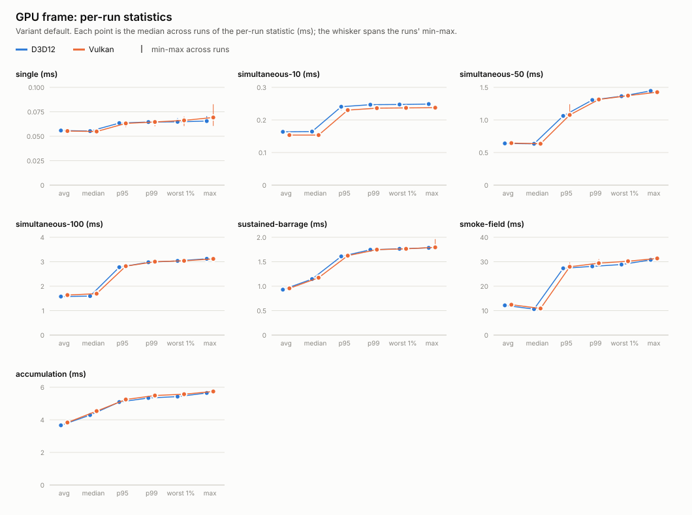

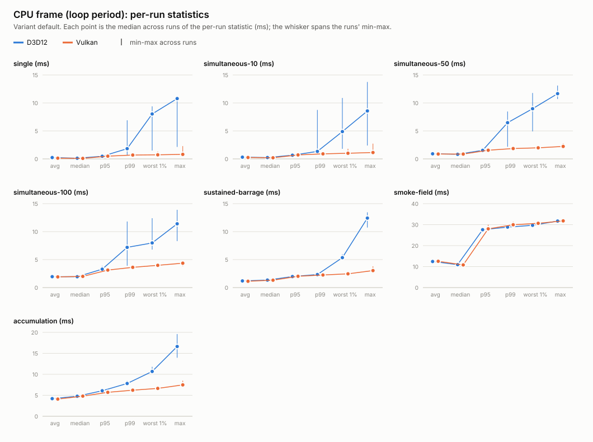

*CPU frame statistics. D3D12's long tails sit in the frame-slot fence wait; their cause is not explained.*

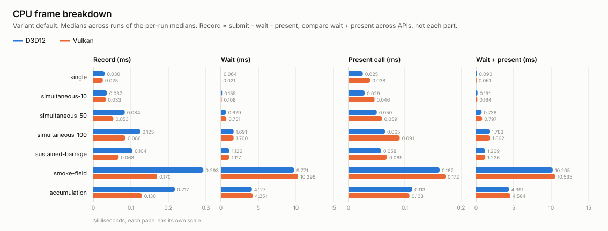

*CPU frame breakdown. Record = submit - wait - present. Compare wait + present across APIs, not each part: DXGI may
block in `Present` where Vulkan blocks on the fence or the acquire.*

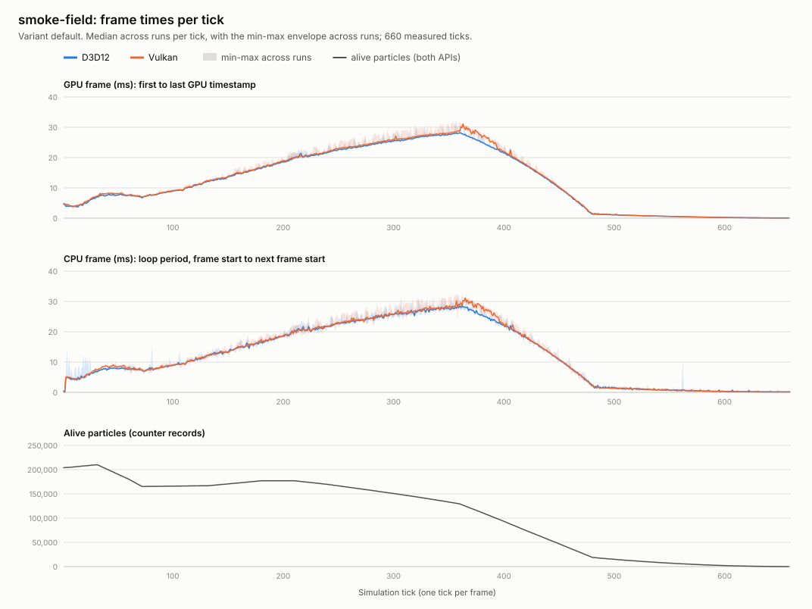

*The smoke field tick by tick: GPU frame, CPU frame and alive particles, median across runs with the min-max
envelope.*

### The recommended set

`--smoke-resolution=auto --half-light --smoke-lod=16` against every option off (relative difference of the medians;
D3D12 / Vulkan):

| Benchmark | GPU frame average | GPU frame p95 | CPU frame median |
|---|---:|---:|---:|
| single | -5.89% / -5.00% | -12.90% / -12.01% | -3.90% / neutral |
| simultaneous-10 | -29.47% / -25.27% | -41.28% / -38.62% | -20.04% / -22.86% |
| simultaneous-50 | -35.27% / -35.39% | -46.09% / -46.77% | -32.85% / -36.58% |
| simultaneous-100 | -40.24% / -40.51% | -47.33% / -45.02% | -37.79% / -36.61% |
| sustained-barrage | -44.35% / -45.92% | -50.73% / -51.13% | -43.07% / -43.88% |
| smoke-field | -84.20% / -84.01% | -85.97% / -86.14% | -78.22% / -77.57% |
| accumulation | -50.25% / -49.84% | -45.63% / -45.44% | -44.65% / -45.93% |

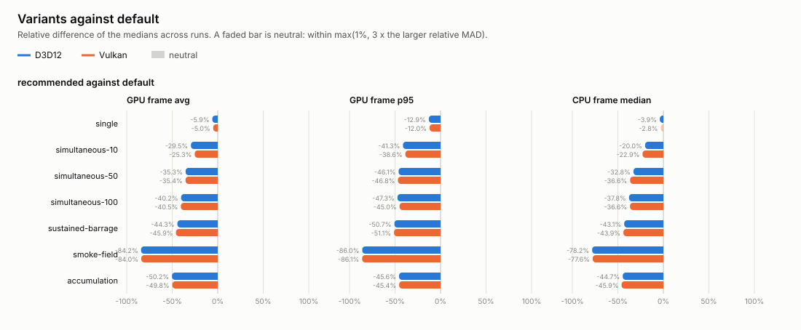

- `auto` switches smoke to half resolution once the newest measured coverage (from a frame about two frames back)
  reaches a budget (1,000 screens by default), and back to full once it falls to 80% of the budget, with at least
  30 frames between switches. Every frame equals a full- or a half-resolution frame exactly, and a run that never
  reaches the budget is identical to full resolution. `--half-light` keeps light in the same back-to-front list. `--smoke-lod=16` thins smoke particles
  whose projected radius exceeds 16 pixels.
- It is not the default because each part changes the image: softer smoke on half-resolution frames, slightly
  reshaped silhouettes of young clouds near the camera.
- **Sensitivity check:** on the sustained barrage the draw average falls 45.59% (D3D12) and 46.98% (Vulkan), against
  45% and 47% for the same workload in the M19 experiments: the M20 harness reproduces the earlier result.

### Attribution

From the region session (`--gpu-regions`, 3 runs; for attribution only, since Vulkan regions serialize the GPU):
- `simultaneous-100` on D3D12: Particles pass 1.500 ms, Scene pass 0.033 ms, particle simulation 0.020 ms.
- `smoke-field` on D3D12: Particles pass 12.702 ms.
- Across all benchmarks and both APIs, the simulation dispatch averages 0.006-0.033 ms and the scan and scatter
  0.001-0.005 ms each.

### GPU memory

Per-process usage as each driver estimates it, sampled after the warm-up and at the end. D3D12 (DXGI) starts at
53.3 MiB local and Vulkan (`VK_EXT_memory_budget`) at 58.1 MiB; the two APIs count differently, so the figures are
not comparable across them.

### Reproduce

```text
python tools/bench/run.py --exe <dir or Pyroclast.exe> --label mine --runs 5 --variant default=--smoke-resolution=full "--variant=recommended=--smoke-resolution=auto --half-light --smoke-lod=16"
python tools/bench/report.py out/bench/<session> --strict
```

`run.py` copies the executable into the session, records the machine, refuses to start while Pyroclast or a build is
running, and interleaves the runs. `report.py` re-checks every record against its CSV, determinism across runs and
APIs and the session's completeness, and rewrites the tables and charts byte-identically.

### The realism model at 1920x1080

The sections above measure the earlier model at 1280x720 (M20). The realism model's budget is 16.7 ms of GPU frame
at p95 at 1920x1080 on this GPU. Session `20261009-091243-m25-s3-final` (M25, executable SHA-256
`91e1ae708dbb96035c93e5b887c62a75b31913a2d95a1e51de4d0c48e3369841`), 5 runs per case, both APIs, borderless at the
display's 1920x1080; every option off (`default`) and the recommended set. Milliseconds, GPU frame p95 / average:

| Benchmark | Variant | D3D12 | Vulkan |
|---|---|---:|---:|
| linger-barrage | default | 7.847 / 5.203 | 8.198 / 5.469 |
| linger-barrage | recommended | 4.261 / 2.829 | 4.495 / 2.981 |
| linger-far | default | 3.101 / 2.036 | 3.263 / 2.141 |
| linger-far | recommended | 1.932 / 1.297 | 2.033 / 1.362 |
| linger-ground | default | 11.843 / 7.888 | 12.346 / 8.265 |
| linger-ground | recommended | 6.184 / 4.129 | 6.515 / 4.347 |

- `linger-barrage` is the target: 240 artillery-he impacts on a 30 m disc, four a second for 60 s, then 30 s more,
  from the overview; `linger-far` watches it from 260 m with a 40-degree field of view; `linger-ground` stands in the
  smoke at eye level, the case the plan said cannot be budgeted (it is reported, not a target).
- The draw is about 11 µs per screen of smoke coverage at 1080p (records 11 and 13); the simulation stays under 0.05 ms.
- What each part costs (records 13 and 15): rising columns about 7%, haze 2-3%, the refraction 0.4-1% of the frame
  while a front is listed (0.07 ms for 16 rings), 16 condensation domes 0.1 ms. The M25 look pass (billows, lights as
  spheres, the phase function, the ejecta crown) added 57-59% to the barrage's draw at p95 (an interleaved A/B
  against M24's build).
- The target uses 47% (D3D12) and 49% (Vulkan) of the budget at p95 with every option off; even the ground pose fits.
  The recommended set takes 37-48% off, all of it from the 16-pixel thinning: `auto` stayed at full resolution in
  every run (record 16). Vulkan is 4-5% slower than D3D12 at p95 here. GPU memory at the end of a run: 112-132 MB
  (DXGI local usage).
- The earlier model is unchanged: an interleaved A/B of M21's build against M25's on the seven M20 benchmarks is
  neutral on 190 of 196 metrics, and the other 6 were neutral in a 7-run re-check.

**The helicopter (M26).** Session `20261009-185704-m26-s3-session` (M26, executable SHA-256
`2a5eeaaa996fe1d19fb954d5904451b9ff6533fa6bd83368340a79c7f950bb3b`), the same method. `heli-hover` runs the lingering
barrage's impacts, wind and pose with the helicopter added (from the overview); `heli-ground` the same from the ground
pose, inside its brownout. Milliseconds, GPU frame p95 / average:

| Benchmark | Variant | D3D12 | Vulkan |
|---|---|---:|---:|
| heli-hover | default | 9.421 / 6.117 | 9.947 / 6.441 |
| heli-hover | recommended | 5.065 / 3.323 | 5.321 / 3.504 |
| heli-ground | default | 14.964 / 9.701 | 15.710 / 10.175 |
| heli-ground | recommended | 7.906 / 5.122 | 8.346 / 5.399 |
| linger-barrage | default (the same session) | 7.849 / 5.208 | 8.201 / 5.469 |

- Against linger-barrage the helicopter adds 1.57 / 1.75 ms at p95. Without its air and dust (`--disable=rotor`, a
  second session) heli-hover is 8.155 / 8.556 ms, so the air and dust are 1.27 / 1.39 ms, nearly all of it drawing the
  dust: the rotor's air for every lingering particle adds about 0.005 ms to the compute dispatches.
- From the ground inside the brownout it uses 90% / 94% of the budget with every option off (reported, not a target);
  the recommended set takes 45-47% off both.
- Without a helicopter nothing changed: an interleaved A/B of M25's build against M26's on the three linger
  benchmarks is neutral on 48 of 48 metrics, and M21's against M26's on the seven M20 benchmarks on 183 of 196; a
  7-run re-check found 12 of the other 13 neutral, and Vulkan accumulation's compute average 3.9% higher both times
  (1.3 µs, on shaders byte-identical to M21's; its frame neutral); it also read Vulkan sustained-barrage's compute 1.7%
  lower.

## Optimization record

Every change is judged the same way: a baseline, region timestamps, a hypothesis, a toggle, an interleaved A/B,
image captures, and a written record, kept even when the change is rejected. The records:

| Record | Status | Headline |
|---|---|---|
| 00 Baseline | evidence | At full resolution the particle pass is 97.8-99.9% of the draw interval in every frozen grid-100 and bombardment state. Half resolution removes 69-73% of the draw in the grid-100 and bombardment states. Hiding the opaque debris makes heavy 100@45 1.16 ms slower: debris writes depth, so smoke behind it is rejected before shading. |
| 01 Coverage counters | kept, off by default | Screen coverage per frame, counted in the scatter: R² 0.979 against 0.334 for the alive count; about 5 µs of draw per screen. |
| 02 Smoke resolution policy | kept, off by default | Heavy grid-100: draw -68% average and -73% p95. A trigger on the particle count was rejected: in the heavy bombardment its draw p95 was 11.87 ms against 5.00 ms with the coverage budget. |
| 03 Smoke thinning, faint floor | thinning kept (P = 16); both off by default | Heavy and artillery-he workloads at full resolution: draw -45% to -48% average, -46% to -49% p95. No popping between consecutive ticks. The floor removes a visible ground haze, so it stays a quality trade. |
| 04 Off-screen culling | rejected | Exact images, but 0.3-0.9% saved even with every effect behind the camera. |
| 05 Effect order | `cloud` key kept as an option | Neutral in cost and invisible in the look check; slot order (`none`) shows that the order between effects matters. A per-effect sort, OIT and a global sort were not built. |
| 06 Slot policy | evict-oldest kept as an option | Removes the 1.7-4.7 s windows without a new impact under saturation, at +32-35% average draw (artillery-he and heavy). |
| 07 Simulation side | not built | Each candidate is bounded by the whole simulation region, tens of microseconds. |
| 08 Draw side | not built | Aggregation, HiZ, CPU and GPU bounds, OIT and a global sort, each with the evidence that would reopen it. |
| 09 D3D12 tearing presentation | kept | Neutral on every metric; the closest match to Vulkan's `IMMEDIATE`. It does not remove D3D12's CPU tails. |
| 10 1080p baseline | measurement | The seven M20 benchmarks at 1920x1080: smoke-field's p95 is 60 ms with every option off and 8 ms with the recommended set; the others stay under 11 ms. |
| 11 Residual budget | kept as designed | The lingering barrage at 1080p cost 4.7-4.8 ms at p95 with M22's lingering smoke, about 11 µs per screen of coverage; the residual size cap was not recalibrated. |
| 12 Graduation sweeps | not built | Four survivors in eight would need a ring larger than the one-level scan holds; nothing measured is limited by the graduation time. |
| 13 Smoke physics cost | kept | Rising columns +7.5% (more coverage), haze +2-3%; sheared wind and variation make the frame slightly cheaper. |
| 14 Far-view haze | kept | Distant smoke fades like the terrain; 2% of the far view's frame. |
| 15 Blast waves cost | kept | 0.07 ms for 16 refraction rings at 1080p, 0.1 ms for 16 condensation domes. |
| 16 1080p coverage budget | not built | Not needed: the realism model meets its budget with every option off. |
| 17 Automatic thinning size | not built | Not needed, for the same reason. |
| 18 Defaults | decided | The realism model is the default; the recommended set stays opt-in (with every option off the target uses under half the budget, and the set's thinning changes the image). |

Earlier decisions, measured the same way:

| Decision | Result |
|---|---|
| Scene target format | R11G11B10F costs 65-68% more draw than RGBA16F on this GPU (it does not blend at full rate); HDR costs +0.41 ms (D3D12) / +0.47 ms (Vulkan) over 8 bits on dense smoke. RGBA16F kept. |
| Analytic box collision for the props | Collision plus deflection cost far below the decision rule's 25% of the simulation region, so the analytic boxes stayed and no depth-buffer collision was prototyped. |
| Generalized barriers, resizable-BAR placement, pipeline decisions | See [D3D12 and Vulkan](#d3d12-and-vulkan) and [GPU particle pipeline](#gpu-particle-pipeline). |

## Correctness and validation

- **Exact image gate.** 192 reference captures (both APIs, full and half resolution, fixed states, named poses,
  every preset, and the range scenario) are compared exactly after every code step; they matched at every M19, M20 and
  M21 step. Refactors must match them exactly until a milestone deliberately changes the image.
- **Cross-API.** The tolerance is at most 2 levels with up to 9 outlier pixels (an opaque edge can cover a pixel
  centre on one API only) and 99.9% of pixels within 1 level; 96/96 pairs pass. Without opaque debris the APIs agree within one level; a
  debris fragment's edge can leave single pixels further apart (up to 35 levels before fragments got a 1.5-pixel
  minimum size, one or two pixels beyond 2 levels after it), which the outlier allowance covers.
- **Cross-vendor.** Measured once, at M13b (100 explosions at tick 180, before debris, lit smoke and props): the
  Intel UHD 770 and WARP differed from the RTX 4090 by at most 7 levels, and from each other by at most 2. Later
  milestones check that both run validation-clean.
- **Determinism.** Scenario and benchmark particle counts are identical run to run and across APIs, and each
  benchmark has a recorded checksum. Captures through `--benchmark` equal captures through `--scenario` exactly.
- **Native validation.** Debug runs require the D3D12 debug layer or the Vulkan validation layer and end with
  "validation summary: 0 warnings, 0 errors". D3D12 GPU-based validation and Vulkan GPU-assisted validation run once
  per milestone (Vulkan reports its known setup notices, 4 before M26 and 13 with the helicopter's pipelines, and 0
  errors).
- **The realism model.** Its own exact baselines (116 Debug captures: the lingering barrage from the overview and the
  far view, one heavy charge, the saturation script; run to run exact, cross-API within tolerance), the legacy gate
  run with `--realism=off`, and no-pop checks: consecutive frames through a graduation, under forced fades and early
  graduations, from a still camera over a barrage, each compared with its neighbours (no step stands out), against
  the evict-oldest pop the model replaces. Counter logs, including the residual pool's columns, are identical across
  runs and APIs.
- **The helicopter.** Its own baseline (88 Debug captures of the three scripts from four named poses, both APIs, full and half
  resolution); frozen frames equal scenario frames at its listing, unlisting, slot end and touchdown; no-pop checks
  through the touchdown, the brownout's onset and end, the climb-out, the descent and the slot's end. Counter logs are
  identical across runs and APIs, and on every scripted frame without explosions the GPU's dust count must equal the
  CPU's prediction (0 mismatches). Its images differ between the APIs by up to 8 levels where the rotor has moved the
  most smoke, and Debug Vulkan's by up to 3 levels between runs in a few brownout frames (Release is exact; unexplained).
  WARP needed one change: its shader compiler crashed on the dissolve's dither table.
- **Lifecycle.** `tools/lifecycle.ps1` drives the interactive path under validation: the controls, the showcase keys,
  30 resizes, minimize and restore, and a minimized start.
- **Release repeatability.** Optimized D3D12 output is not always bit-identical between runs on this driver, so the
  exact gates use Debug builds.

## Limitations

- Windows only.
- Timings come from one GPU (RTX 4090); the UHD 770 and WARP were used for correctness only.
- No bloom and no automatic exposure; exposure is a constant.
- No sun shadows: props are grounded by contact and cover shading only, and point lights leak through walls.
- Half-resolution smoke without `--half-light` composites all smoke under all light, unlike the full-resolution
  order, and its edges against nearer geometry are half resolution.
- No sorting within an effect, and no order-independent transparency.
- Each scalability option changes the image, so none is on by default.
- 128 effect slots: with every slot busy the realism model makes a new event wait while an older explosion graduates
  early (dropped only when none can); the earlier model drops it.
- The realism model's refraction is screen-space: smoke in front of a front is bent too. The condensation dome is
  drawn before all smoke, so smoke behind it is drawn over it.
- Draw units are sorted per effect by view depth: with a still camera they never swap, but a moving camera can swap
  two overlapping columns in one frame (no sorting within an effect, no OIT).
- Sustained high impact rates shorten the linger (about 28 s at 12 artillery impacts a second), smoothly.
- The rotor's bite is a draw term: a puff is drawn torn while the wake's air reaches it and re-fattens within 1-2 s
  after the air leaves it (its displacement persists). From the side a pass through a thick pall still reads subtly:
  the wake is about 13 m wide and the puffs 6-11 m.
- The star's knots are laid along an arc without drag, and the trails of every charge use one design table; the knots
  are smoke puffs, so a tendril is a chain of 1-2 m knots rather than a continuous ribbon.
- The helicopter's wake is the induced flow of a skewed tube: without skew it creates and loses no air, with skew it is
  slightly off across the tube's slanted faces. No trailing vortices, no wake memory of past positions.
- With the helicopter, D3D12 and Vulkan images differ by up to 8 levels (counts are identical), and Debug Vulkan's by
  up to 3 levels between runs in a few brownout frames, for a reason not found.
- The charge masses, stabilization heights, gains and the push are design values chosen by look, not measurements.
- Prop collision has documented edge cases: seams between boxes, smoke larger than the hut's interior, a door
  closed to large smoke.
- Slow motion is stepped (about 15 updates a second at 60 Hz); interactive impacts can start up to 3 ticks late
  under catch-up.
- No PIX capture of the 3D frame: hardware counters need an elevated session. The only counters come from the 2D
  prototype.
- Coverage is an estimate: it ignores early-Z, the soft fade and the disc's falloff.
- D3D12's CPU frame tails and its local-memory growth are unexplained.
- Region timestamps are not fenced on D3D12 and serialize the GPU on Vulkan.

## Future work

Each item was analysed or measured and not built; each has the condition that would reopen it.

| Item | Reopen when |
|---|---|
| Removing off-screen particles from the lists | On a GPU where the off-screen listing cost (70-90 µs here) is a large share of the frame budget, or for a workload that lists far more particles than it draws |
| A per-effect GPU sort | A preset's look check shows a layer drawn through its own smoke |
| Weighted-blended OIT, a global particle sort | Something measured calls for them (OIT also needs multiple render targets, which the RHI does not have) |
| Adaptive emission | A compute-bound target, or thinning rejected for quality |
| Simulation-frequency LOD, skipping dead-record stores, a separate prop-contact dispatch | A target where the simulation is a large share of the frame (for example the UHD 770); skipping dead-record stores first |
| Smoke aggregation | Thinning rejected for quality while most coverage still comes from particles above 64 pixels |
| HiZ or occlusion culling | A profiler capture shows many half-resolution smoke fragments behind the range |
| The D3D12 CPU tails | A PresentMon trace (presentation mode per frame) or a fullscreen swapchain |
| Benchmark harness additions: camera motion, a drain phase, a GPU idle-gap classifier, PresentMon telemetry | A measurement needs them (M20 left them out) |
| The blast waves' sound | The audio milestone the realism phase deferred |
| Ground shadows from smoke | A look check asks for them (record 13 measured the headroom) |
| A jet's exhaust and wake | The owner's go-ahead after the helicopter (the dust machinery and the wall jet carry over) |
| A helicopter's trailing vortices and wake memory | A faster pass than 10 m/s through smoke, or the jet |
| A larger residual pool (a two-level scan) | Linger shortened by sustained fire matters, or four survivors in eight are wanted (record 12) |

## Build

Windows x64, Visual Studio 2026 (the **Desktop development with C++** workload with the Windows SDK and the C++
CMake tools), CMake 4.2 or newer.

- **DXC** with both DXIL and SPIR-V support: download the Windows archive from
  [Microsoft's DXC releases](https://github.com/microsoft/DirectXShaderCompiler/releases) and keep its DLLs beside
  `bin/x64/dxc.exe`. Windows SDK builds of DXC can lack SPIR-V; CMake checks the actual compiler. Validated with
  v1.9.2609. CMake searches PATH, `VULKAN_SDK/Bin` and the Windows SDK tools; set `PYROCLAST_DXC` to override.
- **Vulkan SDK** for headers, the loader import library and the Debug validation layers (validated: 1.4.363.0).
  CMake finds it through `VULKAN_SDK`. For a copy-only SDK, set `VULKAN_SDK` and `VK_ADD_LAYER_PATH` before
  configuring.
- **Graphics Tools** (Windows optional feature) for the D3D12 debug layer that Debug builds require.

From the repository root in Developer PowerShell for Visual Studio 2026:

```powershell
cmake --preset windows-x64          # add -DPYROCLAST_DXC="<path>/bin/x64/dxc.exe" if needed
cmake --build --preset debug
cmake --build --preset release
ctest --preset debug
ctest --preset release
```

- The first configuration downloads SDL 3.4.18 and Dear ImGui 1.92.9b from their release archives and verifies
  their SHA-256 checksums. SDL is linked statically, with its GPU and 2D renderer subsystems disabled, so the
  executable needs no DLL beside it.
- Both shader formats are embedded in the executable; the renderer picks its pair at startup. Shader warnings fail
  the build; C++ builds with `/W4 /permissive-`.
- 12 test executables, registered with CTest as `command_line`, `particle_controls`, `draw_validation`, `frame_statistics`, `image_compare`,
  `math`, `terrain`, `environment`, `explosion_system`, `explosion_presets`, `showcase` and `scalability`. The
  benchmark tools have their own tests: `python -m unittest discover -s tools/bench`.
- **Visual Studio:** File > Open > Folder, select the `windows-x64` configure preset and the `debug` or `release`
  build preset, and choose `Pyroclast.exe` as the startup item. Arguments go in `launch.vs.json` (`"args"`); for
  Vulkan Debug with a copy-only SDK also add `VK_ADD_LAYER_PATH` under `"env"`. Keep machine-specific paths in local
  launch settings or the ignored `CMakeUserPresets.json`.
- **Runtime:** Vulkan 1.3 with dynamic rendering, synchronization2 and `VK_KHR_push_descriptor`, a combined
  graphics/compute/present queue, and D3D12's compute limits (1,024 threads per group, 32 KB of group-shared
  memory). `VK_EXT_swapchain_maintenance1` is used when present. Unsupported configurations fail with a diagnostic;
  there is no silent API fallback.
- **Debug validation:** a clean run logs `D3D12 validation summary: 0 warnings, 0 errors` (or `Vulkan ...`) and exits
  0. Debug Vulkan enables synchronization validation and fails at startup if the layer is missing. Loader messages
  from third-party overlays are logged as `Vulkan loader:` and not counted.

Build output stays under `out/`.

## Run

```powershell
.\out\build\windows-x64\Release\Pyroclast.exe                      # D3D12, the showcase
.\out\build\windows-x64\Release\Pyroclast.exe --renderer=vulkan --view=range
```

The window opens at 1280x720 and is resizable. Interactive runs present with VSync, show the overlay and enable GPU
timestamps. Minimizing pauses the simulation; resizing keeps its state.

### Controls

| Input | Action |
|---|---|
| Left click, **F** | Fire the selected count of the selected preset where the cursor (or, while looking around, the crosshair) meets the terrain or a prop; **F** always fires at the crosshair. A prop's material sets the response. |
| **1-7** | Preset: small impact, small HE, artillery HE, heavy, fuel/fire, dust blast, stress test |
| **C** | Count: 1, 10, 50, 100 |
| **B** / **V** | An 80-impact barrage of the selected preset walking across the view through the crosshair / a continuous bombardment of the selected preset around the crosshair (on or off) |
| **T**, **P**, **N** | 0.25x slow motion; pause or resume; one 1/60 s step while paused |
| **H** | The helicopter (realism model): to a hover 12 m over the last click (or the crosshair); again to move it there, or near where it hovers to send it away |
| **Space** / **R** | Restart the startup group (with the realism model: add it to the scene) / clear every effect and its lingering smoke (both stop the barrage and bombardment) |
| **W A S D**, **Q E**, **Shift** | Move; down and up while flying; four times faster |
| Right mouse button, wheel | Look around; change the speed of the current mode |
| **G** | Walk (eye 1.7 m above the terrain or a prop's top, blocked by props) or fly |
| **F2-F7**, **F11**, **Ctrl** with them | Recall or store the camera bookmarks (overview, ground, hill, aerial, range, yard; F11 the far view) |
| **L**, **F8**, **F9** | Effect bounds and collision boxes; spawn regions; wind arrow |
| **F1** | Hide or show the overlay. While the overlay takes keyboard or mouse input, the keys do not reach the application. |

When every effect slot is busy, an older explosion graduates early and the new event waits for its slot (the realism
model); with none able to, or with `--realism=off`, new events are dropped, counted in the overlay and logged.

### Examples

```powershell
$exe = ".\out\build\windows-x64\Release\Pyroclast.exe"
& $exe --explosions=100 --preset=artillery-he                     # a startup group; Space restarts it
& $exe --preset=heavy --wind=8,45,0.6 --disable=shading            # wind, a smoke feature off
& $exe --preset=heavy --smoke-resolution=auto --half-light --smoke-lod=16
& $exe --scenario=barrage                                          # a scripted run, then one JSON line
& $exe --scenario=range --view=yard --disable=deflection
& $exe --scenario=bombardment --preset=artillery-he
& $exe --benchmark=smoke-field --counter-log=smoke-field.csv       # a benchmark record and its per-frame CSV
& $exe --explosions=100 --profile-tick=180 --gpu-regions           # a frozen state, timed per dispatch and pass
& $exe --scenario=range --view=range --capture-to=120 --capture-sequence=out\video\range-120
& $exe --preset=artillery-he                                       # lingering smoke; B for a barrage, Space adds the group
& $exe --scenario=linger-barrage --preset=artillery-he --view=far --linger=90
& $exe --preset=heavy --humidity=95                                # condensation domes around heavy charges
& $exe --benchmark=linger-barrage                                  # the realism model at 1920x1080, borderless
& $exe --scenario=heli-landing                                     # a helicopter lands in its own brownout
& $exe --scenario=heli-hover --preset=artillery-he --disable=brownout     # the rotor's air on the pall, no dust
& $exe --realism=off --scenario=bombardment --slot-policy=evict-oldest   # the earlier model and its pop
```

### Command-line flags

Flags use the exact `--name=value` form and are case-sensitive. Unknown flags, malformed or out-of-range values,
refused combinations and repeated flags (other than `--help`) exit with code 1 before SDL starts; every argument is
validated even when `--help` is present. Checks that need the scenario's length (`--profile-tick`, `--capture-tick`,
`--capture-to` past its end), the file system (a non-empty `--capture-sequence` folder) or the build
(`--gpu-validation` in Release) exit with code 1 after SDL starts.
`--help` prints the usage and exits.

| Flag | Effect |
|---|---|
| `--renderer=d3d12\|vulkan` | Graphics API, chosen at startup (default d3d12). |
| `--adapter=NAME\|warp` | The GPU whose name contains NAME (case-insensitive); `warp` is the D3D12 software rasterizer (use Release). |
| `--explosions=1\|10\|50\|100` | The startup group (default 1). |
| `--preset=NAME` | small-impact, small-he (default), artillery-he, heavy, fuel-fire, dust-blast or stress-test: the startup group, profiles, scenarios and the first click. |
| `--disable=LIST` | Hide layers (dust, smoke, plume, flash, fireball, sparks, debris), the lights, smoke features (curl, vortex, gusts, shading, shadow, emission) or the props (props, collision, deflection); with the realism model also linger, rise, shear, variation, haze, waves, skirt, condensation, push, shake, rotor (the helicopter's air and dust) and brownout (its dust). |
| `--realism=on\|off` | The realism model (default on since M25): lingering, rising smoke that leaves only by fading, haze, visible blast waves; `off` runs the earlier model. Not with `--benchmark`, whose workload fixes the model. |
| `--humidity=P` | Realism model: the air's relative humidity in percent, 0-100 (default 80); above 70% heavy and stress-test charges show a condensation (Wilson) dome, fully from 90%. |
| `--linger=S` | Realism model: lingering smoke lives about S seconds after its explosion (0.87-1.2 times S with variation, less when the residual pool is busy), 10-300 (default 75). |
| `--wind=S,D,G` | Speed 0-40 m/s, heading in degrees from +x towards +z, gustiness 0-1 (default 3,0,0.3). |
| `--view=NAME` | Start at a named pose: overview (default), ground, hill, aerial, range (the north yard's props), yard (close to its walls) or far (from near the range's south edge, with a 40 degree field of view). |
| `--window=WxH` | The window's client size in pixels, 640x360 to 7680x4320 (default 1280x720; a benchmark's own size unless given). |
| `--borderless` | A window without a frame at the primary display's top-left corner, so a display-sized client area fits. |
| `--camera=EX,EY,EZ,TX,TY,TZ` | Start at this eye, looking at this target (metres), instead of `--view`. |
| `--effect-lines` | Start with each effect's origin, normal and reach, and the props' collision boxes, drawn as lines. |
| `--debug-views=LIST` | Start with bounds, boxes, regions, wind or all on. Not with `--effect-lines` or `--scenario`. |
| `--scenario=NAME` | A scripted run, one tick per frame, then a JSON summary: single, grid-10, grid-50, grid-100, barrage, presets, range, bombardment or accumulation; for the realism model linger-barrage (240 impacts, four a second, run for 90 s), linger-saturation (1,200 impacts, 30 a second), or the helicopter over the barrage: heli-hover (a hover above the pall, a descent through it to a low hover), heli-pass (a slow pass through it) or heli-landing (a landing in its own brownout). |
| `--benchmark=NAME` | A named scenario, preset and pose after 120 warm-up frames: single, simultaneous-10, simultaneous-50, simultaneous-100, sustained-barrage, smoke-field or accumulation; the realism model's linger-barrage (from the overview), linger-far (from the far view), linger-ground (from the ground), heli-hover (heli-hover from the overview) and heli-ground (heli-hover from the ground), at 1920x1080. The first seven keep the earlier model. Prints a JSON record. |
| `--profile-tick=N` | Freeze at tick 0-480 (with `--scenario`: 1 up to its duration), with timestamps on and VSync off, and sample the frozen state. |
| `--counter-log=FILE` | With `--scenario` (or `--benchmark`) or `--profile-tick`: one CSV row per frame, written at exit. |
| `--gpu-timing` | GPU timestamp measurements. |
| `--gpu-regions` | Also time every dispatch, pass and the overlay (serializes Vulkan GPU work). |
| `--capture=FILE.png` | Write the first frame drawn at the profile tick, or with `--scenario` and `--capture-tick=N` the frame that draws tick N, then exit. |
| `--capture-tick=N` | With `--scenario` and `--capture`: the tick whose frame is captured. |
| `--capture-sequence=DIR` | With `--scenario` or `--benchmark`: write every frame as `DIR/tick-NNNNNN.png` (DIR new or empty), then exit without a record. |
| `--capture-from=T`, `--capture-to=T` | With `--capture-sequence`: the first and last tick written (default 1 and the script's last tick). |
| `--exit-after=N` | Exit after N submitted frames. |
| `--smoke-resolution=full\|half\|auto` | Smoke at full or half resolution (default full); auto switches per frame on measured coverage. |
| `--smoke-budget=coverage:S\|count:N` | With auto: half resolution from S screens of coverage (default 1000), or from N alive smoke particles. |
| `--half-light` | With half or auto: half-resolution frames draw light at half resolution too. |
| `--smoke-lod=P` | Thin smoke particles larger than P pixels in radius (0 < P ≤ 4096). |
| `--faint-floor=F` | Do not draw smoke whose opacity is below F (0 < F < 1). |
| `--effect-order=origin\|cloud\|none` | Sort effects back to front by origin (default), by the rising cloud's centre, or not at all. |
| `--slot-policy=drop-new\|evict-oldest\|graduate-oldest` | With every slot busy, graduate an older lingering effect early and let the event wait for its slot (the realism model's default), drop the new event (the earlier model's default), or replace the effect that started earliest (earlier model only: it pops). |
| `--coverage` | Count screen coverage and off-screen particles into the counter record. |
| `--scene-format=rgba16f\|r11g11b10f\|rgba8` | Scene target (default rgba16f; rgba8 is a cost reference and bands). |
| `--ui=on\|off` | The overlay (default on; off with `--profile-tick`, `--scenario` or `--benchmark`). F1 hides it. |
| `--gpu-validation` | Debug only: D3D12 GPU-based or Vulkan GPU-assisted validation (slow). |

Combinations: `--benchmark` refuses `--scenario`, `--explosions`, `--preset`, `--view`, `--camera`, `--profile-tick`,
`--exit-after`, `--ui=on`, `--debug-views`, `--effect-lines` and `--realism`. `--capture-sequence` refuses `--capture`,
`--capture-tick`, `--profile-tick`, `--counter-log`, `--ui=on` and `--exit-after`, and needs `--capture-from` ≤
`--capture-to` (each 1-100000).

### Measuring

- Run Release, leave the window focused and untouched at its size (1280x720 unless `--window` or the benchmark says
  otherwise; the realism benchmarks open 1920x1080 borderless). Any input, focus loss, minimizing, resizing or a
  skipped frame invalidates a sample.
- `--profile-tick=T` freezes the startup group (or a scenario) at tick T with VSync off and timestamps on, then
  warms up 120 frames and samples 600. A frozen state runs zero integration steps, so it isolates rendering cost;
  use scenarios or benchmarks for motion. The process keeps running after the sample: add `--exit-after`.
- Scenario, profile and benchmark runs print one JSON line on stdout (build, renderer, GPU, scenario, settings,
  timings, live counts); scripts should read it rather than the log.
- Without VSync, D3D12 presents at interval 0 with tearing allowed where supported, and Vulkan requires
  `IMMEDIATE`. GPU timings drift by a few percent between sessions: compare builds with interleaved runs.

### Tools

```powershell
# Captures: the fixed-state matrix, named poses, scenario frames; compare exactly, or D3D12 against Vulkan
# (--args=--realism=off for the earlier model's gate, out/baselines/m17; without it the realism model's frames)
python tools/captures.py capture --config Debug --out out/baselines/mine --args=--realism=off
python tools/captures.py capture --config Debug --out out/baselines/mine --views ground,hill,aerial --ticks 60,180 --args=--realism=off
python tools/captures.py capture --config Debug --out out/baselines/mine --scenarios range --views range,yard --args=--realism=off
python tools/captures.py capture --config Debug --out out/baselines/realism --scenarios linger-barrage --presets artillery-he --views overview,far --ticks 300,1800,3600
python tools/captures.py compare out/baselines/mine out/baselines/theirs    # exact by default
python tools/captures.py cross-api out/baselines/mine                       # max 2 levels, 99.9% within 1
python tools/captures.py policy-check out/baselines/mine out/auto-captures  # auto captures equal full or half
# Interleaved A/B of two builds (folders holding Pyroclast.exe) on frozen states, scenarios or benchmarks
python tools/ab.py --a <baseline-dir> --b out/build/windows-x64/Release --runs 5
python tools/ab.py --a <baseline-dir> --b out/build/windows-x64/Release --matrix scenarios
python tools/ab.py --a <baseline-dir> --b out/build/windows-x64/Release --benchmarks single,smoke-field --cpu
python tools/ab.py --a out/build/windows-x64/Release --b out/build/windows-x64/Release --scenarios range --a-args=--disable=collision
# Benchmark sessions and their report
python tools/bench/run.py --exe out/build/windows-x64/Release --label mine --runs 5
python tools/bench/report.py out/bench/<session> --strict
# Per-frame counter logs compared run to run
python tools/counter_log.py diff (Get-ChildItem out/logs/*.csv).FullName
# The interactive lifecycle under native validation (the earlier model; -Realism for the realism model)
powershell -File tools/lifecycle.ps1 -Configuration Debug -Renderer vulkan -SmokeResolution half
# A scripted run's frames as numbered PNGs (for video), here ticks 1-360
.\out\build\windows-x64\Release\Pyroclast.exe --scenario=range --view=range --capture-to=360 --capture-sequence=out\video\range-360
```

- `ImageDiff` (built with the project) compares two captures and can write an amplified difference image
  (`--difference=out.png`). Desktop screenshots are not used for correctness.
- `--capture-sequence` captures each frame that draws a tick in its range, through the same capture path as
  `--capture-tick`. Every captured frame waits for the GPU and writes a PNG, so a sequence run prints no record. A
  folder that is not empty (or not a folder), a `--capture-to` past the script's end, a window resized during the
  run, or a window closed before the last frame exits with code 1.
  Sequence frames equal `--capture-tick` captures exactly (Debug, both APIs, including the frames around both of the
  automatic smoke resolution's switches) and repeat exactly run to run on both APIs. A Release sequence of the range
  scenario, 720 frames, took 130.6 s and 447 MB on the machine above (about 0.18 s and 621 KB per frame).

## History

| Milestone | Result |
|---|---|
| Phase 10 | The 2D prototype: scaling baseline, fixed-state profiling, Vulkan memory placement, a PIX capture and optional half-resolution smoke. |
| M11 | A pure refactor with pixel-identical output: the frame as dispatch and pass lists, one binding model, vertex pulling, Vulkan 1.3, in-app capture. |
| M12 | The Dear ImGui overlay (measured values only), `--gpu-regions`, adapter selection, second-vendor validation. |
| M13a | True 3D: camera, reverse-Z depth, the heightfield range, world-space particles, per-effect back-to-front order, soft particles. |
| M13b | HDR scene target and tonemapping, measured against R11G11B10F and 8 bits. |
| M14a | Explosion events, one slab per effect slot, click-to-spawn, fixed-step scripted scenarios. |
| M14b | The GPU particle lifecycle: alive masks, scan, scatter, indirect draws, counter readback, deterministic counts. |
| M15 | Seven presets of layered effects, surface response, debris, temporary lights. |
| M16 | The smoke model: gusty wind, vortex rings, curl noise, sphere-lit and self-shadowed smoke. |
| M17 | The range's props, swept collision, air deflection, the range scenario and its capture baseline. |
| M18 | Showcase mode: aim and fire, counts, barrage, bombardment, walk, bookmarks, slow motion, debug views. |
| M19 | The scalability program: records 00-08 and the options they kept. |
| M20 | Benchmark mode: seven workloads, records and CSVs, the session driver, the report and charts; D3D12 tearing (record 09). |
| M21 | This README, the images, `--capture-sequence` and the recording guide. |
| M22 | The realism model's lingering smoke: the residual pool, graduation, forced fades instead of pops, early graduation instead of eviction; `--window`, `--borderless`, the far view, the realism scenarios and benchmarks. |
| M23 | The realism model's smoke physics and look: rise to a stabilization height and spreading, sheared and veering wind, per-explosion variation, a lingering palette, haze on particles. |
| M24 | The realism model's visible blast waves: the front from Kinney-Graham, refraction in the present pass, the dust skirt, the Wilson dome, the push on lingering smoke, the camera shake; `--humidity`. |
| M25 | A look pass (soot and soil colours, a real fireball's timing, lights as spheres, self-shadowed columns and palls, scattering thin smoke, billows, an ejecta crown, a crisper wave and dome); the push made to return; the 1080p budget met with every option off, and the realism model made the default; `linger-ground`; this README's realism sections and images. |
| M26 | The helicopter: its rotor's air on the smoke, brownout dust, a proxy model, three scripts, the H key and the overlay's button, two benchmarks; the images above. |
| M27 | A look pass after Blastcore references: the star of smoke tendrils behind an impact's thrown clods, a size mix of clods, the rotor's bite (a hole in the pall under a hover, a band behind a pass) and a subtler brownout; the images above. |
